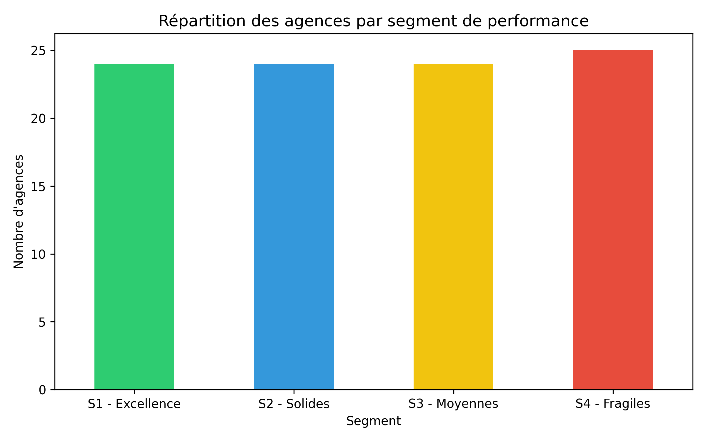

# ✈️ Carrefour Voyages — Agency performance & segmentation

> Score every travel agency of the network on one comparable scale, find what separates the top performers from the rest, and segment agencies into actionable profiles.

**Albert School × Carrefour Voyages business case · November 2025**

> Company data is **not** included — only the analysis pipeline.

---

## Pipeline
```
data_raw/*.xlsx  (monthly performance, recruitment, satisfaction, customer profiles, store attributes, competitors)
   └─► fusion_pipeline.py          merge sources per agency, robust column mapping from config.yaml
   └─► utils/scoring.py            z-scores + weighted themes → one performance score
   └─► analyse_performance.py      Top / Flop by revenue, correlations vs score, quadrants
   └─► analyse_segmentation.py     agency segments & profiles
   └─► build_report.py / generate_rapport_segmentation.py   PDF reports
```

**Scoring themes (weights in `config.yaml`):** performance 35 % · customers 25 % · satisfaction 15 % · structure 15 % · competition 10 %.
**Outputs:** agency scores, Top 5 / Flop 5 by revenue, performance × satisfaction quadrant, segment profiles, automatically generated PDF reports.



*97 agencies split into 4 performance segments: Excellence · Solid · Average · Fragile.*

```bash
python pipeline/fusion_pipeline.py
python pipeline/analyse_performance.py
python pipeline/analyse_segmentation.py
```

## Stack
`Python` `pandas` `NumPy` `PyYAML` `matplotlib` `PDF reporting`

---

### 🇫🇷 En bref
Cas Carrefour Voyages (nov. 2025) : fusion de nombreuses sources Excel par agence, score de performance pondéré par thèmes, analyse Top/Flop, corrélations, quadrant performance × satisfaction, segmentation des agences et rapports PDF générés automatiquement. Données de l'entreprise non publiées.
